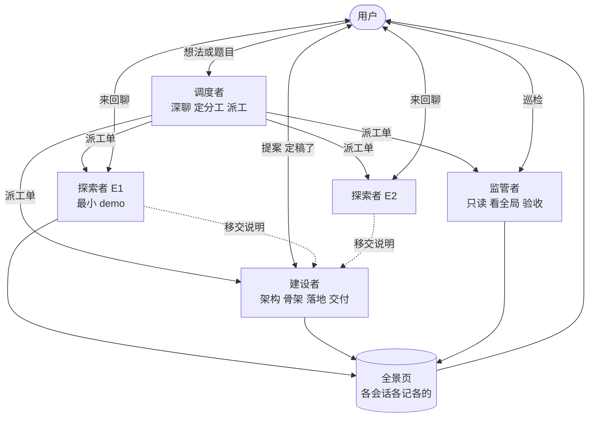
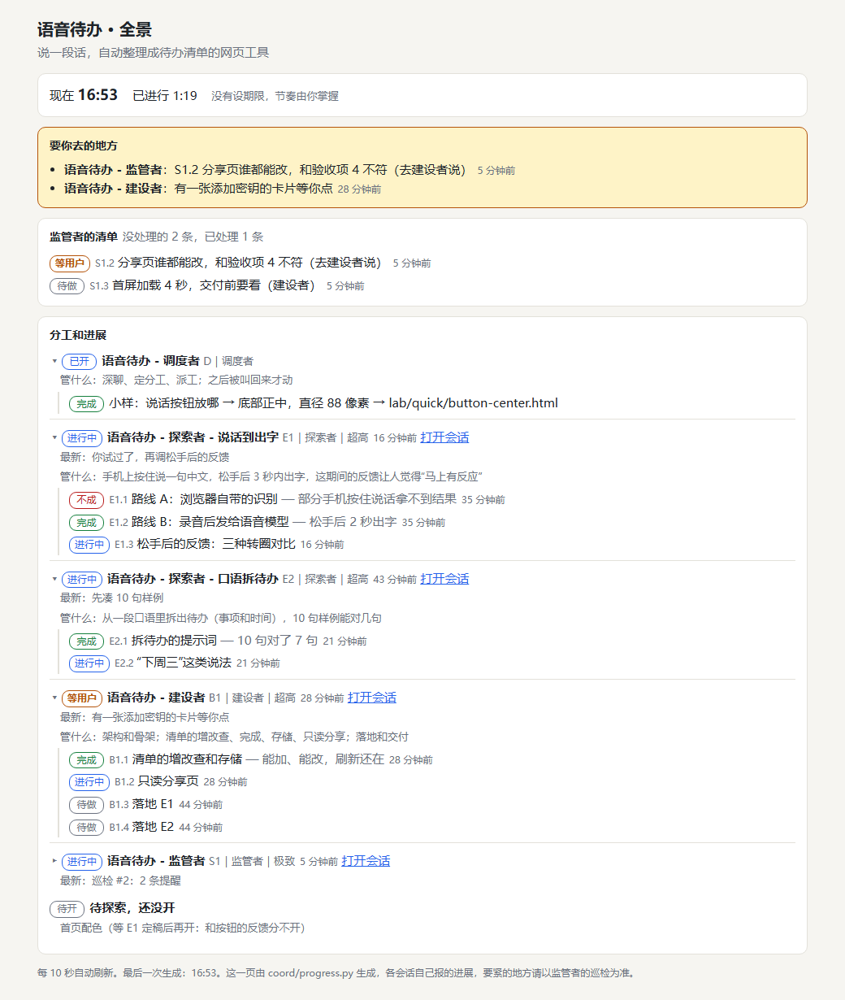

# demo-first

先试后建：给 AI agent 用的多会话协作技能。先和用户把项目聊透，再拆给几个并列的会话；没把握的部分先各做一个最小 demo 试，试成了再写进正式项目。

> **状态：v0.7。** 五个脚本有自动测试，在本机跑通了（Windows、Python 3.12）。整套流程还没有在真实账号上完整跑过，各平台做到哪一步见下面的“支持的平台”。接手开发或者帮忙实测，先读 [`HANDOFF.md`](HANDOFF.md)。

## 作者的话

离额度刷新只剩一两天，Ultra 账号的额度还剩 70%。你有没有为这个发过愁？

我有。token 是够的，不够的是我自己。agent 可以同时开很多个，人不行：每多开一个对话，就多一处要我记着它做到哪了、等着我回去看的地方。额度剩着，不是因为没事可做，是因为我盯不过来。

demo-first 就是为这种处境设计的：**token 相对宽裕，人的精力有限。** 它不帮你省 token，它拿 token 换你的注意力。

- 没把握的事，让几个会话同时各试各的。你只在它们拿出 demo 的时候去挑。
- 盯全局的事，交给一个专门的监管者。它平时不打扰你，出了偏差才出声。
- 所有进展收在一处：一张自动刷新的全景页，加上监管者 20 行以内的巡检。要你做的事最多三件，每件写明去哪、做什么。

所以它天生费 token：同时跑好几个会话，每个会话里还有子代理，用量比一条路做到底要多。额度紧的时候别用它。

## 支持的平台

| 平台 | 状态 |
|---|---|
| Manus | 已按现在的流程适配。它依赖的几条平台机制在 Windows 桌面应用里实测过：开任务时指定名字和档位、附任务引用、各任务共用本机文件夹、任务内部开子代理。整套流程还没有连起来跑过；网页版和云端的任务没测。任务内部开子代理的工具在官方文档里找不到，别的账号上不一定有。实测步骤和结果在 [`tests/manus-mechanics.md`](tests/manus-mechanics.md) |
| Claude Code | 适配文件还停在上一版的流程，开头写明了在它更新之前怎么用。上一版用后台子代理实跑过三轮，见 [`tests/claude-code-trial.md`](tests/claude-code-trial.md) |
| Codex | 在支持列表里，还没做 |

方法本身（会话的分工、台账、派工单、脚本）不绑平台。每个平台只需要一份适配说明，写明怎么开会话、怎么开子代理、文件放哪：[`references/manus-platform.md`](references/manus-platform.md)、[`references/claude-code-platform.md`](references/claude-code-platform.md)。

## 为什么

用 AI 写应用，最容易出问题的做法是在一个对话、一个项目里一路迭代到底。想法在变，代码跟着改，改到后面，项目里全是试验留下的残留，对话里全是过时的结论。

demo-first 把几件事分开：

- **先聊透，再动手。** 做成什么样、哪些地方没把握、每一块的输入输出是什么，在一个会话里和用户聊清楚。一眼能定的事当场用小样定掉。
- **没把握的先试。** 核心玩法、关键交互、视觉风格、技术选型，各用一个最小的 demo 去试。demo 可以随便改、随便扔。
- **有把握的直接建。** 产品边界、整体架构、代码约定，从上往下定好，搭出干净的骨架。
- **试成了再写回去。** demo 定稿后，照架构把结果写进正式项目。正式项目里不做试验。

这几件事互不依赖，可以交给不同的会话同时做，每个会话有自己干净的上下文。

这套分法不是凭空设计的，是做项目时一点点攒下来的：先用一批一次性的小样把最难的效果试出来，再开几个会话把定稿的做法写回正式工程，另有一个会话专门派活、初审。demo-first 把这些经验收成了一套固定的流程和脚本。

## 会话和子代理

| 会话 | 管什么 | 用户怎么参与 |
|---|---|---|
| **调度者** | 起点。和用户深聊，定分工，把每一块开成一个会话。派完工就退出主线，要改分工时再回来找它 | 从这里开始 |
| **探索者** | 用最小 demo 回答一个问题：这个想法成不成。风格和选型也归它。可以有几个 | 直接进它的会话聊，快速迭代 |
| **建设者** | 只有一个。定边界、架构、代码约定，搭骨架；探索定稿一个就写进来一个；最后发布和交付 | 开头看一次提案；探索定稿后来说一句 |
| **监管者** | 只读。冷眼看全局：偏离初始设定、会话之间方向冲突、安全、性能；记着延后的事；最后逐条验收 | 想知道整体怎样、下一步去哪，就来问它 |

每个会话都是用户直接对话的窗口，名字统一是“项目 - 角色 - 细分”。会话手里的活还要分，由它自己开**子代理**：子代理不和用户对话，做完只交回一次。



### 开会话，还是开子代理

每多一个会话，用户就多一处要去的地方，所以分三步判断：

1. **要不要用户来回聊。** 一句话说得清、做出来看一眼就能定的，不开会话：调度者在深聊里当场开子代理做小样，5 分钟、最多两轮。要来回改、看品味、要试几条路的，才是一个探索会话。
2. **两个探索分不分得开。** 看四处：输入、输出、预期效果、交互。有一处是“改这边、那边必须跟着改”，就合成一个会话。一个的输出是另一个的输入、中间的格式定得死，不算分不开。
3. **会话内部由它自己判断。** 每块都能单独做出来给人看（缺的用假数据、占位顶上）的才分给子代理并行；要等另一块的真实结果才定得下来的，按先后做；几行就能改完的自己改。

## 一次协作怎么走

1. **深聊。** 调度者建台账，一轮一轮问，每轮最多 3 个问题。冒出没把握的点，当场归类：能当场定的开子代理做小样，要来回聊的记成待探索。边聊边写初始设定：目标、验收项、不做什么。
2. **定分工。** 把待探索的点分成会话，有把握的部分全归建设者，定好会话之间的接口。发一条分工确认，用户回一句“开”。
3. **派工。** 按“探索者 → 建设者 → 监管者”的顺序，给每个会话生成一份自含的派工单，检查通过后开出来。会话名、思考强度、要附的任务引用，都由脚本给出。
4. **交棒。** 调度者确认监管者读得到各个会话，告诉用户先去哪，然后退出主线。
5. **之后。** 用户直接进各个会话推进。探索定稿了，去建设者那里说一句“E1 定稿了”，建设者照架构把它写进正式项目，demo 是验收基准。想看全局，去监管者那里说“巡检”。功能够了，说一句“冻结”，建设者从这时起只修不加；再说“交付”，建设者发布、写交付说明，监管者在线上链接上逐条验收。

完整的样子见 [`references/example-walkthrough.md`](references/example-walkthrough.md)。

### 节奏由你掌握

技能不设期限，也不给各会话定时间盒。什么时候收、什么时候冻结、什么时候交付，都是你说了算：

- 在某个会话里直接说，或者回调度者那里说一句，由它转给各会话。约定的说法只有四个：“先到这里”（探索照现状给结论）、“冻结”（只修不加）、“交付”、“总检查”。
- 会话自己只有一条防止空转的规矩，和钟点无关：同一个方向来回三轮还定不下来，探索者要停下来给出自己的判断，由你选是接着试、换方向，还是先用降级方案。
- 你自己定了期限的话，可以让调度者记下来。它只显示在全景页上给你看，不写进任何派工单，没有谁会因为它来催你。

## 文档怎么管

重要的事都落在一套叫“台账”的文件里（`coord/`）。会话之间、会话和它的子代理之间，靠这几条规矩对齐：

| 文件 | 谁写 | 什么时候写 | 谁读 |
|---|---|---|---|
| `CHARTER.md` 初始设定 | 调度者；用户回“开”之后冻结，只有用户能改 | 深聊时每定下一件事 | 嵌进建设者和监管者的派工单 |
| `BOARD.md` 分工 | 调度者 | 定分工时；每开一个会话记一次链接 | 脚本从里面取会话名和链接 |
| `DECISIONS.md` 决定 | 调度者 | 跨会话生效的决定 | 被叫回来时先读 |
| `briefs/<编号>.md` 派工单 | 脚本生成，调度者填 | 派工时 | 作为新会话的第一条消息 |
| `tasks/<编号>.md` 任务文件 | 每个会话写自己的 | 四个时机：开工前、用户说了值得记的话、有阶段性结论、完成时 | 接手它的新会话 |
| `handoffs/<编号>.md` 移交说明 | 探索者 | 定稿时 | 建设者落地前先读完 |
| `ARCHITECTURE.md` 架构 | 建设者 | 先改文档，再改代码 | 建设者的子代理、监管者 |
| `WATCH.md` 延后清单 | 监管者 | 每次巡检结束 | 用户、下一任监管者 |
| `progress/<编号>.md` 进展记录 | 每个会话写自己的，只往后加行 | 拆活的时候、关键节点之后 | 脚本合成全景 |

- **每个文件只有一个写者。** 别人只读，想改就写进自己的回报。子代理不写台账，它只交回结果，由开它的会话来记。
- **到点才记，先推进再记。** 记得太勤会拖慢会话和用户的对话。子代理交回、阶段结束时，先把下一批活开出去、先回复用户，然后才记。
- **动手前先读。** 落地前读完移交说明；巡检前重读初始设定；对话被压缩过、隔了很久再接着做，先重读自己的派工单和任务文件。
- **做的人不给自己验收。** 验收项的文字只有用户能改；通没通过，由监管者走过之后标。
- **能交给脚本的不靠自觉。** 拼会话名、数会话名额、检查派工单、记进展和生成全景，都是脚本做的。

这几条和社区里比较一致的做法对得上：子代理只交回摘要、产物写进文件；任务书写清目标、范围、交回格式；并行写同一批文件会出问题；“完成”要有独立的验证；能用一个协调者就不要点对点。出处见文末。

### 全景页

各会话共用一个文件夹时（比如在 Manus 桌面应用里打开 Work locally），派工单不用整份发，只发路径；每个会话还能用一条命令记进展：

```bash
python3 coord/progress.py E1.1 不成 "部分手机拿不到结果" E1.2 完成 "松手后 2 秒出字"
```

每个会话只往自己的文件里加行，所以几个会话同时记也不会撞。脚本把它们合成 `coord/PROGRESS.md` 和 `coord/progress.html`。用浏览器打开后者，它每 10 秒自动刷新：分工和进展是一棵树，等用户处理的事顶在最上面，监管者没处理的清单单列一栏。



各会话不共用文件夹时（云端的任务各有一台机器），全景页只有调度者的那一份，各会话的进展靠去监管者那里巡检来看。

## 技能里有什么

```text
SKILL.md                        调度者的操作手册：深聊、定分工、派工、交棒
scripts/                        只用 Python 标准库
  init_ledger.py                建台账
  new_brief.py                  生成分工确认和三种派工单的草稿；给出会话名、思考强度、要附什么
  check_brief.py                发出前检查：没填的、新会话看不懂的、太长的，都拦下来
  clock.py                      看哪些会话还开着，记会话结束；生成阶段报告的草稿
  progress.py                   记一条进展，重新生成全景；会被复制进台账，各会话直接运行
templates/
  brief-explorer.md             探索者的派工单
  brief-builder.md              建设者的派工单
  brief-supervisor.md           监管者的派工单
  rules-subagent.md             开子代理的规矩，会嵌进每份派工单
  project-instruction.md        项目主指令
  coord/                        台账的空白模板：初始设定、分工、决定、分工确认、阶段报告
references/
  example-walkthrough.md        一个项目从头到尾的完整样例
  manus-platform.md             Manus：平台事实，子代理怎么开，默认做法走不通时的退路
  claude-code-platform.md       Claude Code：开会话、读回报这些动作怎么做（还停在上一版流程）
  long-project.md               项目要做好几天时要留意什么
tests/
  manus-mechanics.md            Manus：平台机制的实测清单，和技能本身的试用办法
  claude-code-trial.md          Claude Code：上一版流程的试用办法和实跑范围
  test_scripts.py               脚本的自动测试
dev/
  pack.py                       打成可以上传的 zip
  lint.py                       检查 Markdown 的表格、代码块和样例
HANDOFF.md                      交接说明：初衷、设计思路、没验证的地方、接下来测什么
```

每份派工单都是自含的：新会话看不到调度者的对话，也不一定读得到这个技能，所以角色的规矩、回报的格式、记录的时机、开子代理的规矩都写在派工单里。

## 安装

脚本需要 Python 3.8 以上，只用标准库。

### Manus

需要一个能同时跑多个任务的套餐。

1. 拿到技能：运行 `python dev/pack.py` 打一个 zip，或者直接用本仓库的链接 `https://github.com/wowsunny/demo-first`。
2. 在 Manus 里打开 Skills → **+ Add**，选 **Upload a skill** 上传 zip，或者选 **Import from GitHub** 贴仓库链接。
3. 在 Project 里用的话，把它加进这个 Project 的技能库。

### Claude Code

把仓库克隆到个人技能目录，然后新开一个会话：

```bash
git clone https://github.com/wowsunny/demo-first ~/.claude/skills/demo-first
```

只想给一个项目用，就克隆到这个项目的 `.claude/skills/demo-first`。

## 使用

在 Manus 里，在 Project 里新开一个任务，模式选 Max 里最高的两档之一；在 Claude Code 里，进到项目目录启动会话。然后输入：

```text
/demo-first
我想做：<你的想法>
交什么：<线上链接、代码……>
没把握的地方：<写成具体的问题，一条一个；可以不写>
```

它会建台账，和你聊几轮，一眼能定的事当场做小样给你看，然后发一条分工确认：初始设定、要开哪些会话、最多 3 个要你定的问题。你回“开”，它就开会话，并告诉你先去哪个。

之后：

- 进各个会话推进具体的事。第一次开任务会弹出 **Allow these actions?**，点 **Allow in this task**。
- 探索定稿了，去建设者的会话说一句“E1 定稿了”。
- 想看全局，去监管者的会话说“巡检”；各会话共用一个文件夹时，直接看全景页。
- 要加开、合并会话，或者要改初始设定，回调度者那里。

想单独开某个角色（比如开不了并行任务时，手动开一个监管者做冷启动检查），就新开一个任务或会话，输入 `/demo-first 你是监管者`。

## 先在本机看看脚本

```bash
python scripts/init_ledger.py --name 试一下 --goal "试一下" --dir demo-run
python scripts/clock.py --dir demo-run
python demo-run/coord/progress.py E1.1 进行中 "第一块活"
python tests/test_scripts.py
```

第三条命令之后，用浏览器打开 `demo-run/coord/progress.html` 就是全景页。

## 几个取舍

- **节奏归用户，不归技能。** 期限、取舍、什么时候收，都是用户的事。技能只保证用户随时看得到全局，说一句话就能让所有会话换挡。
- **调度者不监听。** 任务不会自己醒来，所谓监听其实是用户回去催。它后面管的事各有更合适的人：落地归建设者，全局归监管者，交付归建设者和监管者。它只在要改分工时被叫回来。
- **思考强度每次写明。** 有的平台新会话默认继承开它的会话（太重），有的平台子代理默认最低档（太轻）。脚本给每个会话定好档位：监管者最高，因为它的用处就是找出别人想得不够深留下的问题。
- **省着用用户的注意力。** 用户同一时刻只和一个会话深聊。给用户的消息只有三种：要你定（附推荐，不回就按推荐走）、要你看（给链接）、知会。只有四类事可以停下来等用户：不可逆的；超出初始设定的；看品味的；每条路都只能猜的。
- **越复杂越容易出问题。** 全景只有一种记法：一条命令，七个状态词，文件只往后加行。规矩写在命令自己的帮助里，派工单里只留一句“先推进，再记”。

## 参考

- Manus 官方文档：[Parallel Tasks](https://manus.im/docs/features/parallel-tasks.md)、[Projects](https://manus.im/docs/features/projects.md)、[Skills](https://manus.im/docs/features/skills.md)、[Automations](https://manus.im/docs/automations.md)、[Manus Studio](https://manus.im/docs/features/desktop.md)。
- [Agent Skills 规范](https://agentskills.io/specification)和 Anthropic 的[技能写作指南](https://platform.claude.com/docs/en/agents-and-tools/agent-skills/best-practices)：SKILL.md 的结构、渐进加载、脚本和检查循环。
- Anthropic《[How we built our multi-agent research system](https://www.anthropic.com/engineering/multi-agent-research-system)》《[Effective harnesses for long-running agents](https://www.anthropic.com/engineering/effective-harnesses-for-long-running-agents)》《[Building a C compiler with a team of parallel Claudes](https://www.anthropic.com/engineering/building-c-compiler)》：子代理只交回摘要、产物写进文件；开头按固定顺序读进度；“完成”要有独立验证。
- Anthropic《[Worse Together](https://alignment.anthropic.com/2026/worse-together/)》：一个协调者比点对点好；动手前先读完消息能挽回大半失败。
- Cursor《[Scaling long-running autonomous coding](https://cursor.com/blog/scaling-agents)》、Cognition《[Don't Build Multi-Agents](https://cognition.ai/blog/dont-build-multi-agents)》：多个写者抢同一份文件会出问题；子代理该拿多少上下文，各家有分歧。
- [obra/superpowers](https://github.com/obra/superpowers) 的 subagent-driven-development：现成的派工模板、回报的几种状态、“自己做的决定要记下理由和代价”、易走偏的地方列成表，都受它启发。
- 张涛《[Rebuilding Manus with Manus](https://manus.im/blog/rebuilding-manus-with-manus)》：分诊、执行、验证三个 agent 各司其职；用一个 agent 监督其他 agent；没有可检查的终点，自主循环会失控。

## 路线图

见 [TODO.md](TODO.md)。下一步是在 Manus 上做一次真实的完整使用，然后把 Claude Code 的适配文件改到新流程，之后是 Codex。

## 许可

MIT，见 [LICENSE](LICENSE)。
