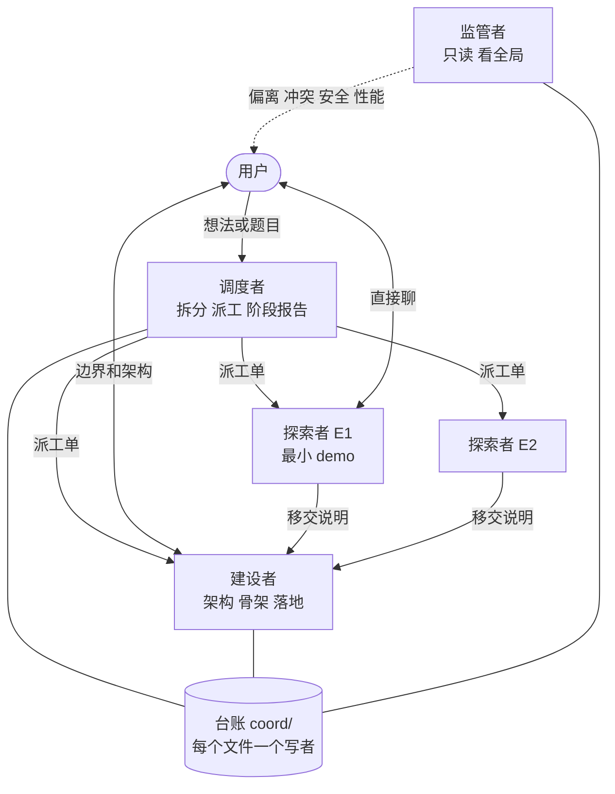

# demo-first

先试后建：给 AI agent 用的多任务协作技能。没把握的部分先各做一个最小 demo 试，试成了再写进正式项目。

> **状态：v0.4。** 四个脚本有自动测试，在本机跑通了（Windows、Python 3.12）。各平台做到哪一步，见下面的“支持的平台”。

## 作者的话

离额度刷新只剩一两天，Ultra 账号的额度还剩 70%。你有没有为这个发过愁？

我有。token 是够的，不够的是我自己。agent 可以同时开很多个，人不行：每多开一个对话，就多一处要我记着它做到哪了、等着我回去看的地方。额度剩着，不是因为没事可做，是因为我盯不过来。

demo-first 就是为这种处境设计的：**token 相对宽裕，人的精力有限。** 它不帮你省 token，它拿 token 换你的注意力。

- 没把握的事，让几个任务同时各试各的。你只在它们拿出 demo 的时候去挑。
- 盯全局的事，交给一个专门的监管者。它平时不打扰你，出了偏差才出声。
- 所有进展收成一份 20 行以内的阶段报告，要你做的事最多三件，每件写明去哪、做什么。

所以它天生费 token：同时跑好几个任务，用量比一条路做到底要多。额度紧的时候别用它。

## 支持的平台

| 平台 | 状态 |
|---|---|
| Claude Code | 已适配，有两种开法。桌面应用里，探索者和建设者各开成一个子会话，你可以直接点进去聊；没有开会话工具的环境（终端里的命令行版），开成后台子代理，由主会话替你传话。后一种实跑过：一个没有上下文的调度者，用后台子代理把一个小项目从立项做到落地和巡检。子会话的开法试过一次，能开工、能回报、能收消息，但发现它比子代理重十几倍，这一种的规则还在调整。从斜杠命令加载技能还没验证。验证过的范围和试用办法在 [`tests/claude-code-trial.md`](tests/claude-code-trial.md) |
| Manus | 已适配。整套流程还没有在真实账号上完整跑过；依赖的平台行为里有十几处官方文档没写清楚，实测步骤和试用办法都在 [`tests/manus-mechanics.md`](tests/manus-mechanics.md) |
| Codex | 在支持列表里，还没做 |

方法本身（四个角色、台账、派工单、脚本）不绑平台。每个平台只需要一份适配说明，写明怎么开任务、怎么读结果、文件放哪：[`references/claude-code-platform.md`](references/claude-code-platform.md)、[`references/manus-platform.md`](references/manus-platform.md)。

## 为什么

用 AI 写应用，最容易出问题的做法是在一个对话、一个项目里一路迭代到底。想法在变，代码跟着改，改到后面，项目里全是试验留下的残留，对话里全是过时的结论。

demo-first 把两件事分开：

- **没把握的先试。** 核心玩法、关键交互、视觉风格、技术选型，各用一个最小的 demo 去试。demo 可以随便改、随便扔。
- **有把握的直接建。** 产品边界、整体架构、代码约定，从上往下定好，搭出干净的骨架。
- **试成了再写回去。** demo 定稿后，照架构把结果写进正式项目。正式项目里不做试验。

这几件事互不依赖，可以交给不同的任务同时做，每个任务有自己干净的上下文。

## 四个角色

| 角色 | 管什么 | 用户怎么参与 |
|---|---|---|
| **调度者** | 会话的起点。立项、拆分、派工、维护任务树、出阶段报告、组织落地。自己不写代码 | 从这里开始，看阶段报告 |
| **探索者** | 用最小 demo 回答一个问题：这个想法成不成。风格和选型也归它 | 直接进它的任务聊，快速迭代 |
| **建设者** | 总建设者定边界、架构、代码约定，搭骨架；落地建设者把定稿的探索写进正式项目 | 开头看一次边界和架构的提案 |
| **监管者** | 只读。冷眼看全局：偏离初始设定、任务之间方向冲突、安全、性能；记着延后的事 | 平时不打扰，出事才出声 |

探索者和建设者都可以有多个，也可以分层。调度者和监管者分开，是因为干活的人被自己的上下文带着走，换一个没有上下文的人来看，判断常常不一样。



## 一次协作怎么走

1. **立项。** 调度者建台账，写下初始设定（目标、验收项、不做什么、时间关口），把项目拆成“没把握的”和“有把握的”，发一条开工确认。用户回一句“开”。
2. **派工。** 调度者给每个任务生成一份自含的派工单，检查通过后开出独立任务。
3. **巡检。** 探索者各试各的，用户直接进去聊；总建设者同时定架构、搭骨架；监管者在外面看。用户说“报告”，调度者就查一轮，出一份 20 行以内的阶段报告。
4. **落地。** 探索定稿后交一份移交说明，建设者照架构把它写进正式项目，demo 是验收基准。
5. **交付。** 冻结功能，过一遍监管者的延后清单，逐条验收，写交付说明。

完整的样子见 [`references/example-sprint.md`](references/example-sprint.md)。

## 技能里有什么

```text
SKILL.md                        调度者的操作手册：立项、派工、巡检、落地、交付
scripts/                        只用 Python 标准库
  init_ledger.py                建台账，算时间关口和并行上限
  new_brief.py                  生成开工确认和四种派工单的草稿，已知的内容先填好
  check_brief.py                发出前检查：没填的、新任务看不懂的、太长的，都拦下来
  clock.py                      现在几点、过了哪个关口、哪个时间盒超了；生成阶段报告的草稿
templates/
  brief-explorer.md             探索者的派工单
  brief-lead-builder.md         总建设者的派工单
  brief-landing-builder.md      落地建设者的派工单
  brief-supervisor.md           监管者的派工单
  project-instruction.md        项目主指令
  coord/                        台账的空白模板：初始设定、任务树、决定、开工确认、阶段报告
references/
  example-sprint.md             一次四小时冲刺的完整样例
  manus-platform.md             Manus：平台事实，和默认做法走不通时的退路
  claude-code-platform.md       Claude Code：子会话和子代理两种开法，开任务、读回报这些动作怎么做
  long-project.md               按天算的项目有哪些不同
tests/
  manus-mechanics.md            Manus：平台机制的实测清单，和技能本身的试用办法
  claude-code-trial.md          Claude Code：试用办法，和已经实跑验证过的范围
  test_scripts.py               脚本的自动测试
dev/
  pack.py                       打成可以上传的 zip
  lint.py                       检查 Markdown 的表格、代码块和样例
```

每份派工单都是自含的：新任务看不到调度者的对话，也不一定读得到这个技能，所以角色的规矩、回报的格式、记录的时机都写在派工单里。

## 安装

脚本需要 Python 3.8 以上，只用标准库。

### Claude Code

把仓库克隆到个人技能目录，然后新开一个会话：

```bash
git clone https://github.com/wowsunny/demo-first ~/.claude/skills/demo-first
```

只想给一个项目用，就克隆到这个项目的 `.claude/skills/demo-first`。

### Manus

需要一个能同时跑多个任务的套餐。

1. 拿到技能：运行 `python dev/pack.py` 打一个 zip，或者直接用本仓库的链接 `https://github.com/wowsunny/demo-first`。
2. 在 Manus 里打开 Skills → **+ Add**，选 **Upload a skill** 上传 zip，或者选 **Import from GitHub** 贴仓库链接。
3. 在 Project 里用的话，把它加进这个 Project 的技能库。

## 使用

在 Claude Code 里，进到项目目录启动会话；在 Manus 里，在 Project 里新开一个任务。然后输入：

```text
/demo-first
我想做：<你的想法或题目>
什么时候交：<几点，或者多少小时；带上时区>
交什么：<线上链接、代码……>
没把握的地方：<写成具体的问题，一条一个；可以不写>
```

它会建台账，发一条开工确认：初始设定、任务树、最多 3 个要你定的问题。你回“开”，它就开任务。之后随时说“报告”，看阶段报告。

两个平台上不一样的地方：

- **Manus**：每个任务是 Project 里的一个独立任务，你可以直接点进探索者的任务和它聊。第一次开任务会弹出 **Allow these actions?**，点 **Allow in this task**。
- **Claude Code**：所有任务都在你的项目目录里工作。在桌面应用里，探索者和建设者各是一个子会话，出现在侧栏里，你可以直接点进探索者的会话和它聊。在终端里的命令行版，它们是后台子代理，不能和你直接对话：探索者拿出 demo 时，主会话会叫你来看，你在主会话里回话，它原话转过去。监管者在两种环境里都是一个只读的子代理。

想单独开某个角色（比如开不了并行任务时，手动开一个监管者做冷启动检查），就新开一个任务或会话，输入 `/demo-first 你是监管者`。

## 先在本机看看脚本

```bash
python scripts/init_ledger.py --goal "试一下" --hours 4 --tz +08:00 --dir demo-run
python scripts/clock.py --dir demo-run
python tests/test_scripts.py
```

## 几个取舍

- **文档为准。** 重要的事都落在一套叫“台账”的文件里（`coord/`），每个文件只有一个写者。任何任务都要能只凭文件，被一个全新的任务接手。
- **到点才记。** 只在四个时机记：一件事开工前；用户说了值得记的话之后；出现阶段性的重要结论时；完成时。记得太勤，会拖慢任务和用户的对话。
- **省着用用户的注意力。** 用户同一时刻只和一个任务深聊。给用户的消息只有三种：要你定（附推荐，不回就按推荐走）、要你看（给链接）、知会（攒进阶段报告）。只有四类事可以停下来等用户：不可逆的；超出初始设定的；看品味的；每条路都只能猜的。
- **能交给脚本的不靠自觉。** 算时间、盯时间盒、数并行名额、检查派工单，这些事 agent 靠自觉容易出错，所以写成了脚本。

## 参考

- Manus 官方文档：[Parallel Tasks](https://manus.im/docs/features/parallel-tasks.md)、[Edit in New Task](https://manus.im/docs/website-builder/edit-in-new-task.md)、[Projects](https://manus.im/docs/features/projects.md)、[Skills](https://manus.im/docs/features/skills.md)、[Automations](https://manus.im/docs/automations.md)。
- [Agent Skills 规范](https://agentskills.io/specification)和 Anthropic 的[技能写作指南](https://platform.claude.com/docs/en/agents-and-tools/agent-skills/best-practices)：SKILL.md 的结构、渐进加载、脚本和检查循环。
- [obra/superpowers](https://github.com/obra/superpowers) 的 subagent-driven-development：现成的派工模板、回报的几种状态、“自己做的决定要记下理由和代价”、易走偏的地方列成表，都受它启发。
- 张涛《[Rebuilding Manus with Manus](https://manus.im/blog/rebuilding-manus-with-manus)》：分诊、执行、验证三个 agent 各司其职；留一个主会话专门列需要人决定的事；用一个 agent 监督其他 agent。

## 路线图

见 [TODO.md](TODO.md)。下一步是在 Claude Code 和 Manus 上各做一次真实的完整使用，之后是 Codex。

## 许可

MIT，见 [LICENSE](LICENSE)。
